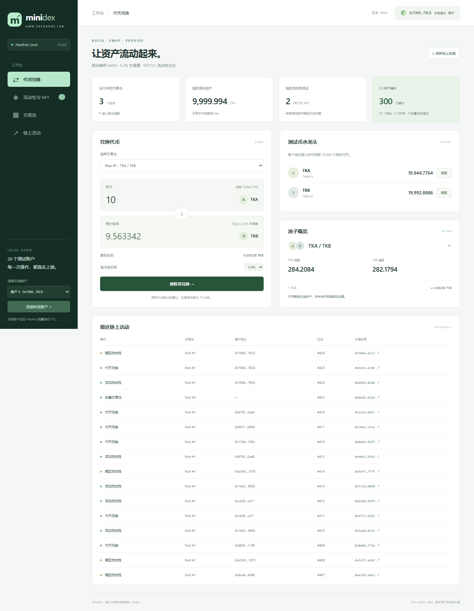
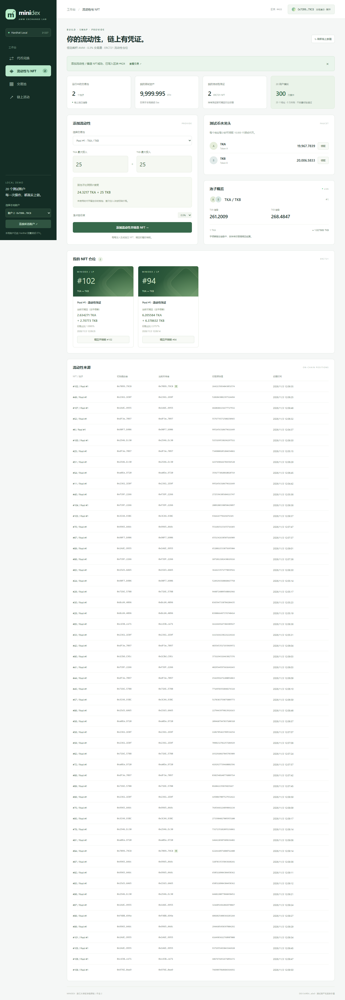
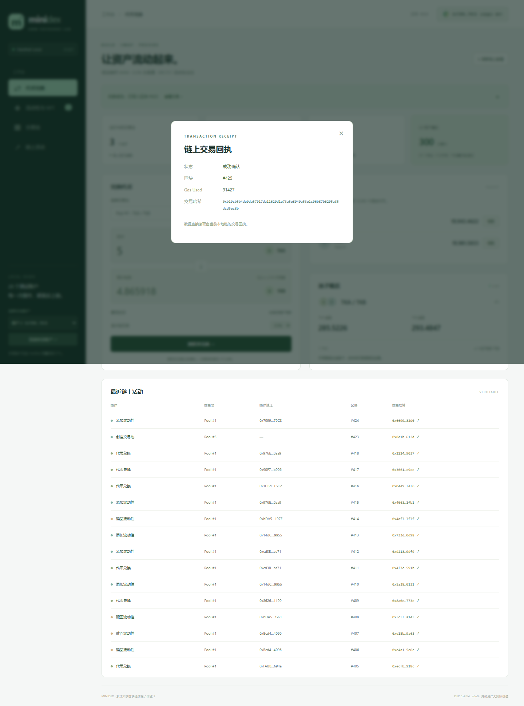
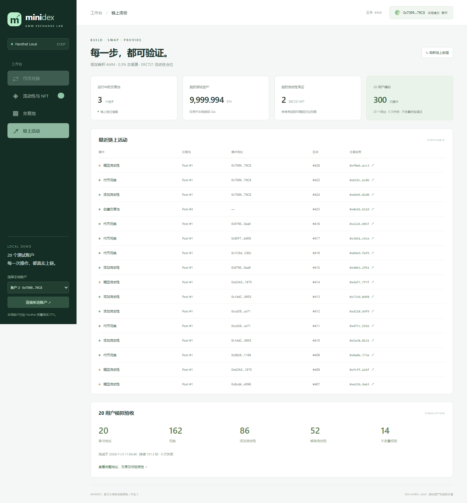

# MiniDEX · AMM Exchange Lab

基于恒定乘积 AMM 的去中心化交易所 DApp，运行于本地 Hardhat 区块链。项目实现 ERC20 测试代币、用户创建交易池、双向兑换、ERC721 流动性仓位，以及 20 个独立地址的链上随机模拟。

## 功能概览

| 功能 | 实现 |
| --- | --- |
| 至少两个 ERC20 | 同一 TestToken 合约部署为 TKA、TKB；每地址每小时可领取 10,000 个 |
| 用户创建 AMM 池子 | 前端输入两个标准 ERC20 地址建池；地址排序去重；支持多个交易对 |
| 恒定乘积交易 | 双向兑换、0.3% 手续费、最低接收量、交易有效期 |
| 添加流动性 | 按现有比例接受两币，未使用的资产保留在用户钱包 |
| ERC721 流动性凭证 | 每次注入获得独立 NFT，链上保存池子、份额、投入、时间和原始提供者 |
| 来源与仓位查询 | 展示每个池子的活跃仓位、原始提供者、当前所有者和当前账户的 NFT |
| 移除流动性 | 当前 NFT 所有者整份赎回并销毁凭证；按当前储备分配资产与手续费权益 |
| 多用户模拟 | 20 个地址执行 300 次随机操作；记录交易哈希并持续校验资产及份额 |
| 简易前端 | React + ethers；支持 MetaMask、本地演示账户和交易回执 |

## 快速运行

运行环境为 Node.js 24、npm、Git 和 Chrome 浏览器。两个工程均包含 package-lock.json，使用 npm ci 安装锁定版本的依赖。

Windows 一键启动，在本项目根目录执行：

```powershell
powershell -ExecutionPolicy Bypass -File .\start.ps1
```

访问 **http://127.0.0.1:3000**，在左侧选择测试账户，点击连接即可使用。没有钱包插件也能使用真实本地链交易。

启动并运行一轮完整模拟：

```powershell
powershell -ExecutionPolicy Bypass -File .\start.ps1 -Simulate
```

停止一键脚本启动的服务：

```powershell
powershell -ExecutionPolicy Bypass -File .\stop.ps1
```

启动脚本将服务隐藏运行，日志和 PID 保存在忽略提交的 `.runtime/` 中。复用已有的同网络节点；首次或节点重启后自动部署。合约修改后请加 `-Redeploy` 重新部署。

### 手动运行

终端一（保持运行）：

```powershell
cd contracts
npm ci
npm run node
```

终端二：

```powershell
cd contracts
npm run deploy
```

部署脚本会部署两种代币和 DEX，为部署者领取测试币，并创建 1,000 TKA / 1,000 TKB 的初始池子。ABI 与地址自动写入 `deployments/localhost.json` 和 `frontend/src/generated/deployment.json`。

终端三（保持运行）：

```powershell
cd frontend
npm ci
npm start
```

默认 RPC 为 `http://127.0.0.1:8545`，Chain ID 为 `31337`。账户连接、代币领取和各项操作见 [使用说明](docs/USAGE.md)。

### MetaMask

添加上述本地网络，将 Hardhat 节点打印的一个测试账户导入钱包，再在页面点击“连接 MetaMask”。链上写入操作需在钱包中确认。账户已有测试 ETH；代币通过水龙头领取。私钥只在本地节点输出，不写入前端源码或仓库。

## 测试与 20 用户模拟

```powershell
cd contracts
npm run typecheck
npm test
npm run simulate
```

模拟连接已启动并部署的 localhost 链，取前 20 个已解锁账户，为每人领取和授权代币、初始化一个仓位，再执行 300 次随机兑换/添加/移除操作。默认操作间隔 250ms，随机种子 20261103。

可在 PowerShell 调整：

```powershell
$env:SIM_STEPS = '300'
$env:SIM_SEED = '20261103'
$env:SIM_INTERVAL_MS = '250'
npm run simulate
```

模拟在相同初始链状态、种子和配置下可复现。初始化交易不计入 300 次随机操作。运行异常立即退出；仅完整成功的运行才覆盖成功报告。

报告生成在 [reports/simulation.json](reports/simulation.json)，并同步到前端 `public/simulation-report.json`。“链上活动”页展示报告。报告包括全部参与地址、逐次操作、交易哈希、Gas、交易费和最终储备。仓库中的报告是一次真实运行的记录；重新部署后，请重新运行模拟获取与当前链对应的新报告。

校验内容：

- 每次兑换后，恒定乘积 k 不下降。
- DEX 持有的代币余额、各池储备和合约负债记账一致。
- 每池 NFT 份额总和加永久锁定份额等于 totalShares。
- 20 个地址都实际参与了随机操作，交易回执均成功。

前端检查：

```powershell
cd frontend
npm test
npm run build
npm run test:e2e
```

浏览器验收需要节点和前端已启动，默认使用已安装的 Chrome。测试覆盖领取代币、部署额外的 TKC、前端创建新池、添加流动性并获得 NFT、兑换、查看回执、赎回以及移动端布局。测试会推进本地链时间以重新验证水龙头，自动化交互使用本地账户模式。

### 测试结果

| 检查项目 | 结果 |
| --- | --- |
| 合约编译与类型检查 | 通过 |
| 合约测试 | 19 项通过 |
| 前端单元测试 | 8 项通过 |
| 浏览器端到端测试 | 2 项通过 |
| 前端生产构建 | 通过 |
| 并发读取检查 | 模拟运行期间连续 12 次刷新通过 |
| 20 用户模拟 | 300 次操作，162 次兑换、86 次添加、52 次移除 |
| 模拟失败次数 | 0 |
| 模拟持续时间 | 101.279 秒 |
| 资产与份额不变量检查 | 14 次通过 |

## 实现分析

### AMM 与手续费

`MiniDEX.sol` 使用一个合约管理多个池子，每池单独记录两币储备。储备不会从整个合约余额直接推算，避免共享同一代币的多个池子相互混账。

对输入数量 d、输入储备 x、输出储备 y：

```text
withFee = d × 9970
amountOut = floor(withFee × y / (x × 10000 + withFee))
```

全部输入 d 进入储备，0.3% 费用隐含留在池子中，不另设领取接口，也不额外重复分红。链上重新计算报价并验证最低收到数量；前端报价仅供预览。

### 流动性份额与 NFT

首次注入时：

```text
root = floor(sqrt(amountA × amountB))
永久锁定份额 = 1000（最小整数单位）
用户 shares = root - 1000
```

锁定少量份额避免池子被完全抽空。锁定份额没有对应的用户 NFT。

后续注入先按现有储备比例确定实际接受数量，再计算：

```text
shares = min(amountA × totalShares / reserveA,
             amountB × totalShares / reserveB)
```

每笔注入都生成可转让的 ERC721。`tokenURI` 返回链上 Base64 JSON，包含 poolId、shares、初始投入、创建时间及原始提供者；`ownerOf` 表示当前所有者。

销毁时：

```text
取回 A = floor(shares × reserveA / totalShares)
取回 B = floor(shares × reserveB / totalShares)
```

手续费已经进入储备，所以取回金额包含按份额享有的手续费权益。兑换会改变资产比例，因此赎回时两种代币数量不一定都比初始投入大。每个 NFT 采用整份赎回，没有部分减仓。

### 保护与边界

使用 OpenZeppelin SafeERC20、ERC721Enumerable 和 ReentrancyGuard；处理滑点、截止时间、授权不足、无效池子、重复池子和所有权。资金状态在外部回调前完成更新或受重入锁保护。测试专门覆盖 NFT 接收回调的重入尝试。

仅支持标准、无转账税、非 rebase 的 ERC20。输入转账数量不符时拒绝并回滚。新池初始价格由首次提供者决定；没有路由器、多跳交易、原生 ETH 交易对、预言机、升级代理或协议分成。手续费全部按 LP 份额归属，不实现生产 Uniswap 的额外治理机制。

### 环境兼容

项目使用 Hardhat 3.19、ethers 6.17、OpenZeppelin 5.4 和 Solidity 0.8.20。编译器固定为项目内的 `solc/soljson.js`，降低运行时对编译器下载及全局缓存的依赖。Windows 原生 EDR 包作为可选依赖锁定版本，其他平台可跳过。

## 项目结构

```text
contracts/
  contracts/TestToken.sol        两种测试币共用实现
  contracts/MiniDEX.sol          池子、兑换、份额及 ERC721
  contracts/mocks/TestHelpers.sol 仅测试使用的辅助合约
  scripts/deploy.ts              部署、初始化与导出 ABI
  scripts/simulate.ts            20 用户持续模拟
  test/testMiniDEX.ts            19 项合约测试
frontend/
  src/App.tsx                   页面与交易交互
  src/lib/dex.ts                RPC、数据查询与金额处理
  src/generated/deployment.json 部署脚本自动生成
  e2e/workflow.spec.ts           浏览器真实链验收
reports/                        运行报告
docs/USAGE.md                   使用说明
frontend/scripts/               验收与截图辅助脚本
start.ps1 / stop.ps1             Windows 本地启动、停止
```

## 运行截图

以下截图均来自本地真实链验收。






手机布局截图：[04-mobile.png](docs/screenshots/04-mobile.png)。当前验证结果见 [reports/verification.md](reports/verification.md)。
